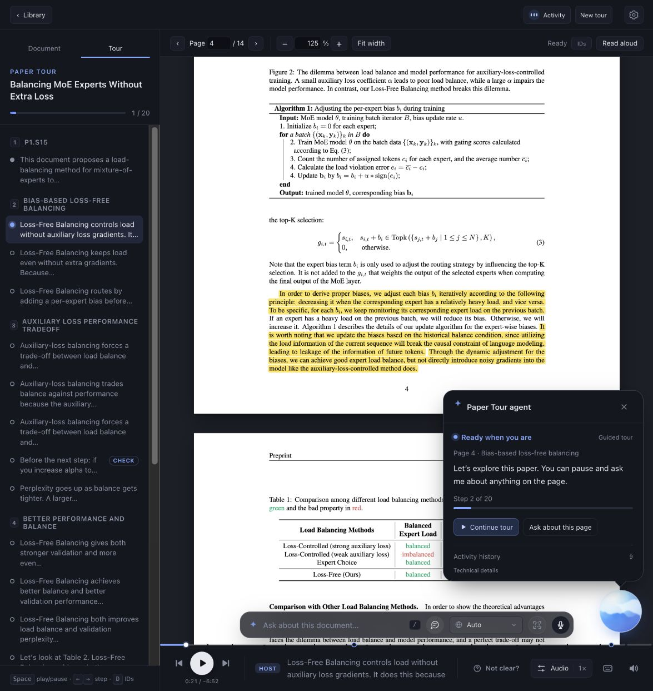
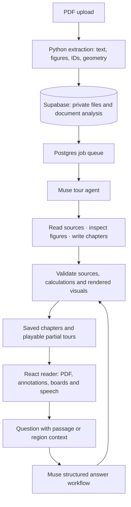

# Paper Tour

**A document tutor that points, draws, and explains.**

Reading a difficult paper often means jumping between the prose, an equation, a figure and another tab with an explanation. Paper Tour brings the explanation onto the page. It reads with you, highlights the passage being discussed, and builds visual explanations beside the original document.

Upload a PDF, choose how you want it taught, and start a guided tour. Pause to ask about a sentence, select part of a diagram, or change a mathematical example through a follow-up question. The source stays in view.

[Get started](#run-locally) · [Architecture](docs/architecture.md) · [Development](docs/development.md)



## Read it. Hear it. Work through it.

- **Choose your explanation.** Organize a tour by concepts, as an overview, or in paper order. Set explanation depth and reader familiarity separately; save your own teaching profiles.
- **Follow the source.** The reader moves between passages, figures and equations as the narration reaches them. Highlights and annotations refer to the PDF's own elements.
- **See the mechanism.** Explanations can build formulas term by term, compare reported results, draw a mathematical construction or expose parameters you can change.
- **Ask where you are stuck.** Type or dictate a question, or select a region of the page. Answers play as short explanations on the document, and conversations remain available when you return.
- **Read aloud.** Listen to source prose with synchronized highlighting and explanations of figures, tables and equations. Pause, seek, change the voice or return to a saved tour.
- **Keep your place.** Saved tours, document conversations and reading progress belong to your account. Completed leading chapters can play while the rest of a tour is still being written.

Research papers, lecture slides, exercise sheets, contracts and letters use different teaching structures. A slide deck follows its slides; an exercise can pause for a try-first checkpoint before revealing a solution.

## Built with Meta's Muse models

Muse supplies the language and visual reasoning. The application supplies document geometry, executable tools, durable state and playback.

| Model | Role in Paper Tour |
| --- | --- |
| **Muse Spark 1.3** (`muse-spark-1.3`) | Default model for tour generation, source explanations and questions. Reads text with PDF page/figure images, writes narration and chooses annotations or authored visuals. |
| **Muse Wonder 1.0** | Selectable reasoning alternative when available to the connected account; it is not a separate required stage. |
| **SAM 3.1** (`sam-3.1`) | Refines a dragged selection into the object inside it. If the result is unsuitable, the reader keeps the original rectangle. |
| **Muse Voice Transcribe 1.0** | Turns a spoken question into editable text before the learner sends it. Document terms and language can guide transcription. |

Model selection checks live account availability when available; a static catalog is used when discovery is unavailable. Contributor variants require explicit consent. Narration uses a separate speech layer: browser voices by default, local Siri on supported Macs, or optional ElevenLabs/OpenAI connections.

## How we built it



**Source IDs connect the model to the page.** Ingestion assigns stable IDs to sentences, equations, figures and other elements. Tour actions reference these IDs, and the reader resolves their PDF geometry. Region selections and authored visual scenes can also carry coordinates; the model does not have to guess where a source sentence sits.

**Tour generation survives a closed tab.** The default tour agent uses the Vercel AI SDK with Meta Responses. Each durable job advances one model step. Seven scoped tools let it read the paper, inspect visual evidence, build a plan and publish chapters. Postgres and pg-boss keep checkpoints, tool results and recovery state. Pause, Resume and Cancel operate on that saved work.

**Visuals are executed and inspected.** Native boards render typed formulas, charts and scenes. For a custom explanation, Muse can author an SVG program or a restricted Plotly figure. QuickJS isolates program execution; validation, numerical checks and rendered review feed repairs before publication. Required visual failures retain the work for correction.

**Questions have their own workflow.** A question retrieves relevant source passages and original-PDF image context, then generates a structured answer tour. It shares tour contracts and visual validation, while conversations persist independently of full tours.

Read the [architecture guide](docs/architecture.md) for the module map, tools and persistence model, or [visual explanations](docs/visuals.md) for execution and rendering details.

## Stack

| Layer | Technologies |
| --- | --- |
| Reader | React 19, TypeScript, Vite, pdf.js, Animate UI / Base UI, Motion |
| Visuals | SVG, KaTeX, Plotly, QuickJS/WASM, Resvg |
| API and worker | Node.js 22+, Fastify, Vercel AI SDK 7, pg-boss |
| PDF processing | Python 3.12, PyMuPDF, OpenCV, Tesseract |
| Data and identity | Supabase Postgres, Auth, private Storage and Vault |
| Deployment | Docker image for the application; Compose for API and worker |

## Run locally

Requires **Node.js 22.12+**, **Python 3.12** and **Tesseract**. Run these commands from a checkout of the repository. The Supabase CLI/runtime may also require Docker or Colima; see [setup details](docs/development.md#prerequisites).

```sh
npm ci
npm --prefix server ci
npm --prefix player ci
python3.12 -m venv ingest/.venv
ingest/.venv/bin/pip install -r ingest/requirements.txt
npm run supabase:start
npm run setup:local -- --skip-siri
npm run db:migrate
npm run dev
```

Open [localhost:5174](http://localhost:5174), create a local account, and add your Meta API key in **Profile & Settings**. Alternatively, set `MODEL_API_KEY` in the generated root `.env` and restart the app. The setup helper creates local configuration and refuses to overwrite existing files.

`--skip-siri` skips voice installation during setup. To also disable automatic Siri installation at API startup, set `SIRI_TTS_AUTO_SETUP=false` in `.env`. Browser speech needs no separate API key. [Development](docs/development.md) covers optional providers, configuration and Docker deployment.

## Development and documentation

```sh
npm run build
npm test
```

CI runs the build and unit suites on pull requests and pushes to `main`. Database integration and paid-provider smoke checks are separate. See [Development](docs/development.md#checks).

| Directory | Responsibility |
| --- | --- |
| `player/` | Library, PDF reader, narration, annotations and visual playback |
| `server/` | API, generation worker, Muse integration and application tools |
| `ingest/` | PDF extraction, local document tools and validation |
| `shared/`, `schema/` | Shared types, expressions, source and tour contracts |
| `supabase/` | Service configuration and database migrations |
| `scripts/` | Setup, integration checks and evaluation utilities |
| `docs/` | Architecture, development and subsystem guides |

- [Architecture](docs/architecture.md) and [document/tour format](docs/tour-format.md)
- [Visual explanations](docs/visuals.md), [reading and audio](docs/reading-and-audio.md), and [interface](docs/interface.md)
- [Local PDF workflows](docs/document-workflows.md)
- [Recorded evaluation](docs/evaluation.md) and [contributor credits](docs/credits.md)
- [Contributing](CONTRIBUTING.md)

## Data and limitations

Uploads are stored in a private, account-scoped library. Generation sends document text and rendered images to Meta; cloud speech sends narration text to the selected provider. This is not an offline-only application. Personal provider keys are stored server-side through Supabase Vault.

Generated explanations can be wrong. Source links, mathematical checks and visual review make results easier to inspect; they do not prove every claim or explanation correct. Scanned-document quality depends on OCR. Contract and letter explanations describe the document and do not provide legal advice. Historical timings in the evaluation notes describe specific older runs, not a current performance guarantee.
